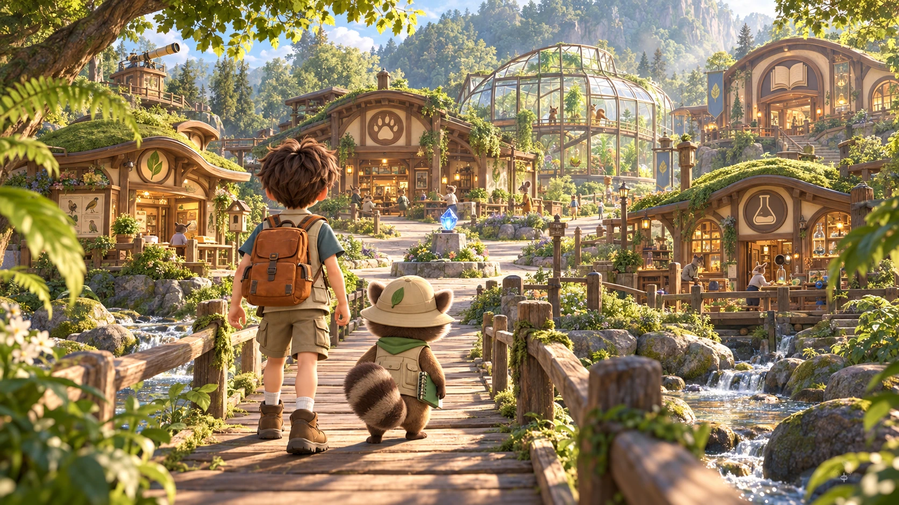
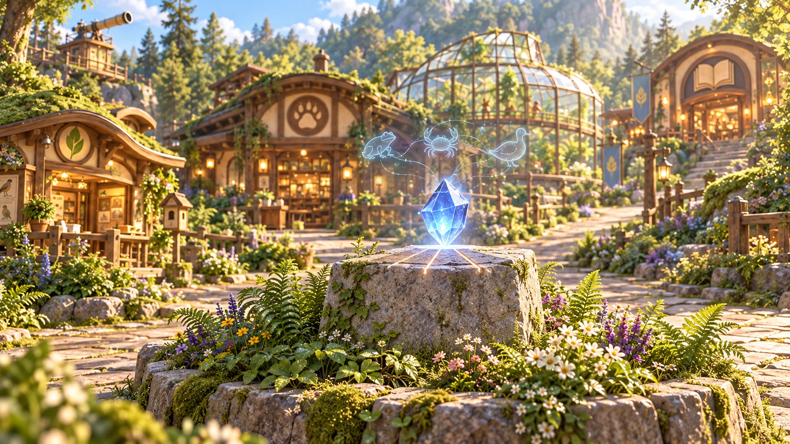
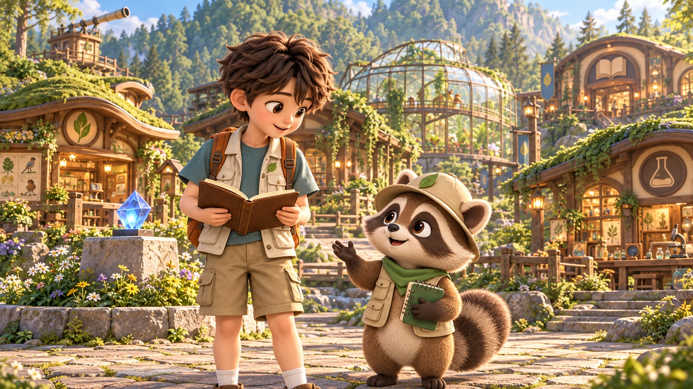
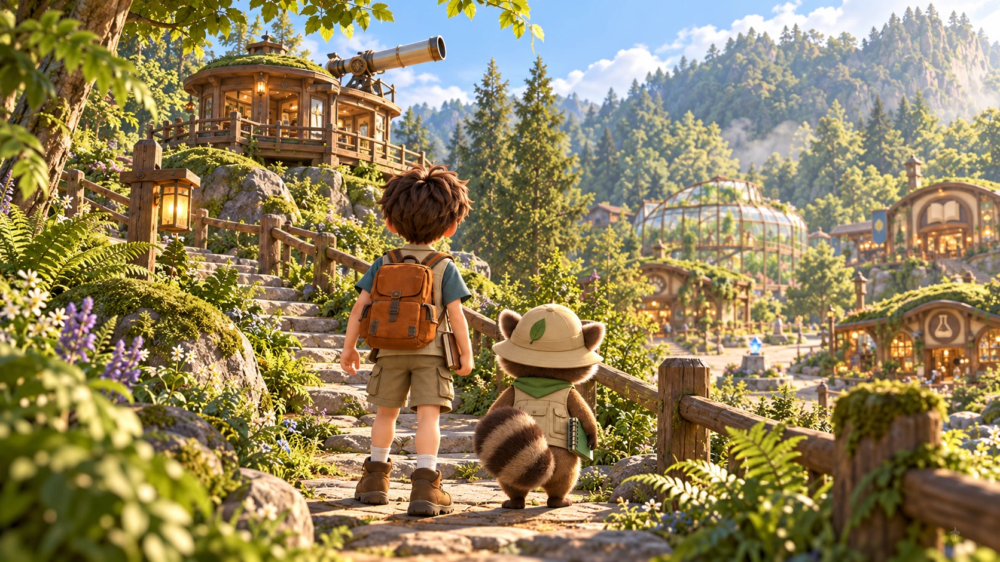
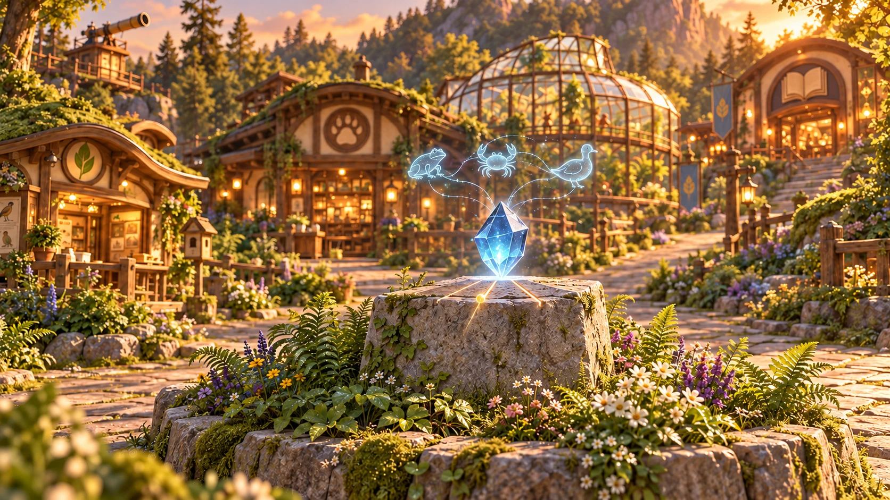
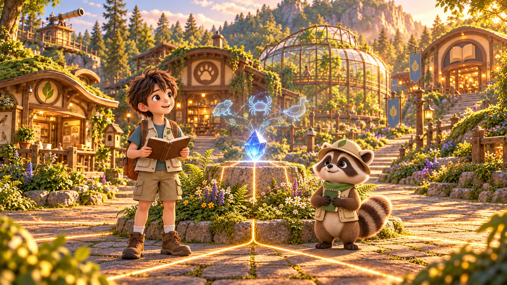
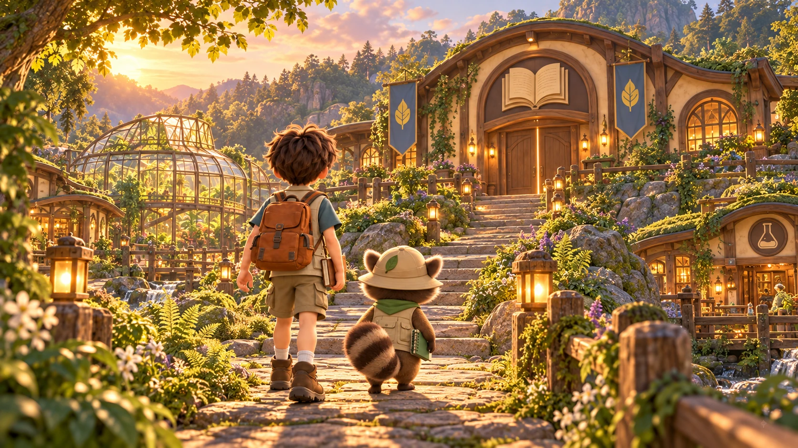
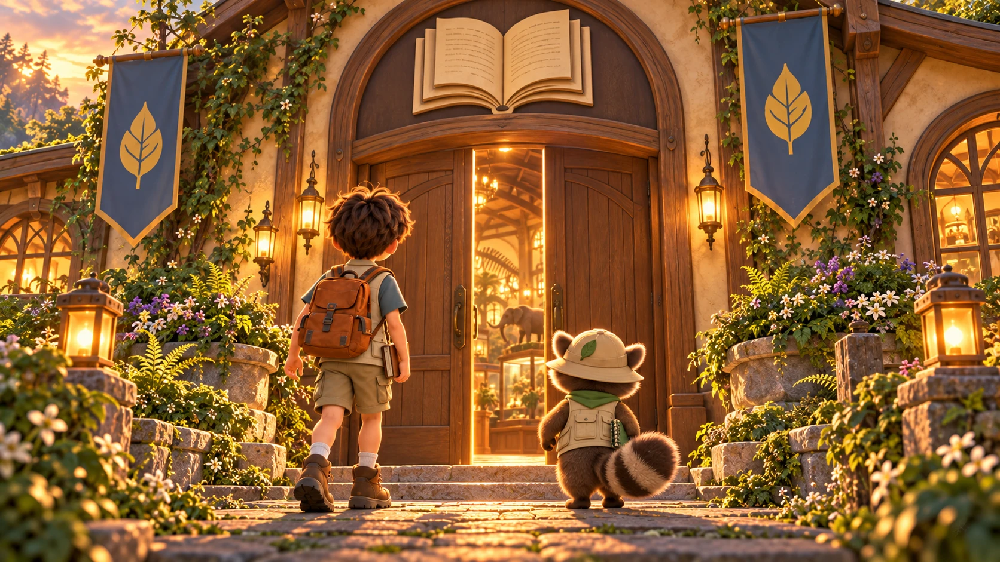

# 기록의 수정 — 완성한 인트로·아웃트로 영상

2026-10-18 · 인트로 24초 + 아웃트로 24초 = 총 48초. 8컷을 각각 생성해 두 편으로 편집했어.

## 이야기와 공간

기록의 수정은 직접 관찰하고 확인한 자연 기록을 모아 전시관에 보여 줘. 기록의 연결이 뒤섞여 전시가 멈췄지만 동물과 자연이 사라지거나 다치지는 않아. 하루와 모리가 다섯 장소의 의뢰를 마치면 기록의 빛이 다시 연결되고, 책 모양 간판의 전시관이 열려.

지도는 건물 역할·배치와 인물 외형 참고로 사용했어. 영상은 사용자의 수정 요청대로 지도 화면을 그대로 움직이는 방식 대신, 같은 마을 안을 걷는 눈높이 장면과 새 카메라 구도로 구성했어. 책이 있는 오른쪽 위 건물이 전시관, 플라스크가 있는 오른쪽 아래 건물이 발명의 공방이야. 마지막에는 실제 앱 전시관으로 넘어가.

## 제작 결과

- 모델: Higgsfield Kling v3.0 Pro, 16:9, 무음. 초기 이미지 8장에 각각 image-to-video 적용.
- 시작 이미지: `assets/story/intro-01.webp`부터 `outro-04.webp`까지.
- 재생본: `assets/videos/story/intro.mp4`, `outro.mp4`. H.264, 24fps, faststart.
- 한글 자막·재생/일시정지·건너뛰기·전체화면은 앱에서 표시해.
- 요청·결과: `STORY-VIDEO-REQUESTS-20261018.json`, `STORY-VIDEO-RESULTS-20261018.json`.

## 실제 생성 컷 시트

| 컷 | 길이 | 카메라 |
|---|---:|---|
| intro-01 | 5초 | Rear child-eye-level wide shot. One slow forward FOLLOW TRACK over 5 seconds behind the companions, maintaining their full bodies in lower frame. Move gently at walking pace across the bridge with foreground parallax. End just beyond the bridge, village plaza opening ahead, hold final 0.7 seconds. |
| intro-02 | 4초 | Eye-level medium close shot, LOCKED CAMERA for 4 seconds. Preserve entire crystal and top of pedestal within frame. End on the same composition with faint crystal glow, holding the last second. |
| intro-03 | 8초 | Eye-level medium-full two-shot, LOCKED CAMERA for 8 seconds. Keep both original faces clearly visible with unchanged sizes and framing. End with both gently looking toward the path to their left, hold 0.8 seconds. |
| intro-04 | 7초 | Rear child-eye-level full shot. One slow forward FOLLOW TRACK along the northwest path for 7 seconds at a child's walking pace. Keep both companions' full bodies visible and telescope cabin ahead left. End near the cabin's lower entrance, stopping with the doorway and telescope visible. Hold last 0.7 seconds. |
| outro-01 | 4초 | Eye-level medium close shot, LOCKED CAMERA for 4 seconds, same framing throughout. End with all five channels illuminated and the crystal softly bright, hold last second. |
| outro-02 | 6초 | Eye-level medium wide two-shot. One slow straight DOLLY OUT over 6 seconds to reveal a little more of the restored plaza. Keep boy, raccoon and crystal central and all feet visible. End at a wide plaza view with book exhibition hall visible uphill right, hold 0.7 seconds. |
| outro-03 | 6초 | Rear child-eye-level wide shot. One slow forward FOLLOW TRACK over 6 seconds toward the book exhibition hall, keeping both companions full body in frame and the door ahead center-right. End near the top steps, two meters before the closed entrance. Hold last 0.7 seconds. |
| outro-04 | 8초 | Child-eye-level entrance shot, one slow straight PUSH THROUGH over 8 seconds, centered on the doorway. Start two meters outside, pass smoothly between the opening doors, stop just inside the gallery looking into its warm interior. Hold final one second, no fade to black or white. |

## intro-01 · 5초



```text
Preserve the exact character identities, faces, outfits, proportions, village architecture and illustrated cinematic style of the starting image. Exactly one boy and one small raccoon when present, no duplicates or new characters. Keep book exhibition hall northeast and flask invention workshop southeast. No generated text, subtitles, logos or UI. Single continuous shot, no cuts.
[CAMERA] Rear child-eye-level wide shot. One slow forward FOLLOW TRACK over 5 seconds behind the companions, maintaining their full bodies in lower frame. Move gently at walking pace across the bridge with foreground parallax. End just beyond the bridge, village plaza opening ahead, hold final 0.7 seconds.
[SCENE] The boy and raccoon take a few relaxed grounded steps together into the village. The boy's backpack and raccoon's striped tail move subtly. Stream flows, leaves stir gently, distant villagers remain subtle. Buildings stay rigid and in place; no aerial camera or zoom.
```

## intro-02 · 4초



```text
Preserve the exact character identities, faces, outfits, proportions, village architecture and illustrated cinematic style of the starting image. Exactly one boy and one small raccoon when present, no duplicates or new characters. Keep book exhibition hall northeast and flask invention workshop southeast. No generated text, subtitles, logos or UI. Single continuous shot, no cuts.
[CAMERA] Eye-level medium close shot, LOCKED CAMERA for 4 seconds. Preserve entire crystal and top of pedestal within frame. End on the same composition with faint crystal glow, holding the last second.
[SCENE] The already confused pale animal-record connections slowly fade away. Five delicate channels lose light gently, leaving a faint cyan spark in the intact blue crystal. No cracks or destruction. Flowers barely move. It is a quiet mystery, not a disaster.
```

## intro-03 · 8초



```text
Preserve the exact character identities, faces, outfits, proportions, village architecture and illustrated cinematic style of the starting image. Exactly one boy and one small raccoon when present, no duplicates or new characters. Keep book exhibition hall northeast and flask invention workshop southeast. No generated text, subtitles, logos or UI. Single continuous shot, no cuts.
[CAMERA] Eye-level medium-full two-shot, LOCKED CAMERA for 8 seconds. Keep both original faces clearly visible with unchanged sizes and framing. End with both gently looking toward the path to their left, hold 0.8 seconds.
[SCENE] Mori makes one small explanatory paw gesture, Haru glances from his brown notebook to Mori and nods once with curiosity. Natural blinks, gentle breathing, small warm smiles. They remain in place; books stay solid in their hands; no talking audio and no exaggerated lip movements. Dim crystal remains behind.
```

## intro-04 · 7초



```text
Preserve the exact character identities, faces, outfits, proportions, village architecture and illustrated cinematic style of the starting image. Exactly one boy and one small raccoon when present, no duplicates or new characters. Keep book exhibition hall northeast and flask invention workshop southeast. No generated text, subtitles, logos or UI. Single continuous shot, no cuts.
[CAMERA] Rear child-eye-level full shot. One slow forward FOLLOW TRACK along the northwest path for 7 seconds at a child's walking pace. Keep both companions' full bodies visible and telescope cabin ahead left. End near the cabin's lower entrance, stopping with the doorway and telescope visible. Hold last 0.7 seconds.
[SCENE] Haru and Mori walk a few small steps up the stone path together toward observation cabin. Natural planted footfalls, subtle tail and backpack sway. Ferns move softly. No teleporting, extra limbs, jumping or location changes. Cabin stays the same.
```

## outro-01 · 4초



```text
Preserve the exact character identities, faces, outfits, proportions, village architecture and illustrated cinematic style of the starting image. Exactly one boy and one small raccoon when present, no duplicates or new characters. Keep book exhibition hall northeast and flask invention workshop southeast. No generated text, subtitles, logos or UI. Single continuous shot, no cuts.
[CAMERA] Eye-level medium close shot, LOCKED CAMERA for 4 seconds, same framing throughout. End with all five channels illuminated and the crystal softly bright, hold last second.
[SCENE] The small incoming golden light travels along the fifth existing channel into the crystal. All five channels gently glow together. The three animal-record outlines become clearly arranged with tidy simple connections, no text. Light warms the nearby ferns and stone without overexposure. No spinning crystal, explosions or new monuments.
```

## outro-02 · 6초



```text
Preserve the exact character identities, faces, outfits, proportions, village architecture and illustrated cinematic style of the starting image. Exactly one boy and one small raccoon when present, no duplicates or new characters. Keep book exhibition hall northeast and flask invention workshop southeast. No generated text, subtitles, logos or UI. Single continuous shot, no cuts.
[CAMERA] Eye-level medium wide two-shot. One slow straight DOLLY OUT over 6 seconds to reveal a little more of the restored plaza. Keep boy, raccoon and crystal central and all feet visible. End at a wide plaza view with book exhibition hall visible uphill right, hold 0.7 seconds.
[SCENE] Haru and Mori smile with quiet pride. Haru closes his brown notebook gently; Mori makes a small inviting gesture toward the book exhibition hall on the right. Gold record paths glow subtly and windows feel warm. No cheers, jumping crowd or large effects.
```

## outro-03 · 6초



```text
Preserve the exact character identities, faces, outfits, proportions, village architecture and illustrated cinematic style of the starting image. Exactly one boy and one small raccoon when present, no duplicates or new characters. Keep book exhibition hall northeast and flask invention workshop southeast. No generated text, subtitles, logos or UI. Single continuous shot, no cuts.
[CAMERA] Rear child-eye-level wide shot. One slow forward FOLLOW TRACK over 6 seconds toward the book exhibition hall, keeping both companions full body in frame and the door ahead center-right. End near the top steps, two meters before the closed entrance. Hold last 0.7 seconds.
[SCENE] Haru and Mori walk up the welcoming path and steps toward the book-emblem hall. Their strides are slow and grounded. Lanterns glow and blue leaf banners stir gently. The door stays closed with a warm thin seam until the next shot. Do not move the greenhouse or turn book emblem into flask.
```

## outro-04 · 8초



```text
Preserve the exact character identities, faces, outfits, proportions, village architecture and illustrated cinematic style of the starting image. Exactly one boy and one small raccoon when present, no duplicates or new characters. Keep book exhibition hall northeast and flask invention workshop southeast. No generated text, subtitles, logos or UI. Single continuous shot, no cuts.
[CAMERA] Child-eye-level entrance shot, one slow straight PUSH THROUGH over 8 seconds, centered on the doorway. Start two meters outside, pass smoothly between the opening doors, stop just inside the gallery looking into its warm interior. Hold final one second, no fade to black or white.
[SCENE] During the first two seconds both oak doors gently swing inward. Haru and Mori take small steps through the entrance on either side, leaving the camera's center passage open. The camera follows into the cozy natural-history exhibition. Soft warm light reveals wooden display cases, simple animal specimens and notebooks without readable text. No transforming objects, no invented personal records, no cuts or duplicated companions.
```

## 검수 범위

영상 8컷의 여러 시점을 추출해 인물·건물·종료 구도를 확인했고, 브라우저에서 인트로 건너뛰기·재생·일시정지와 아웃트로 종료 후 전시관 전환을 점검했어. 무음 영상이므로 대사 음성과 자막 동기화 평가는 해당하지 않아. 실기기 전체화면과 학교 네트워크 스트리밍은 별도 확인이 필요해.
