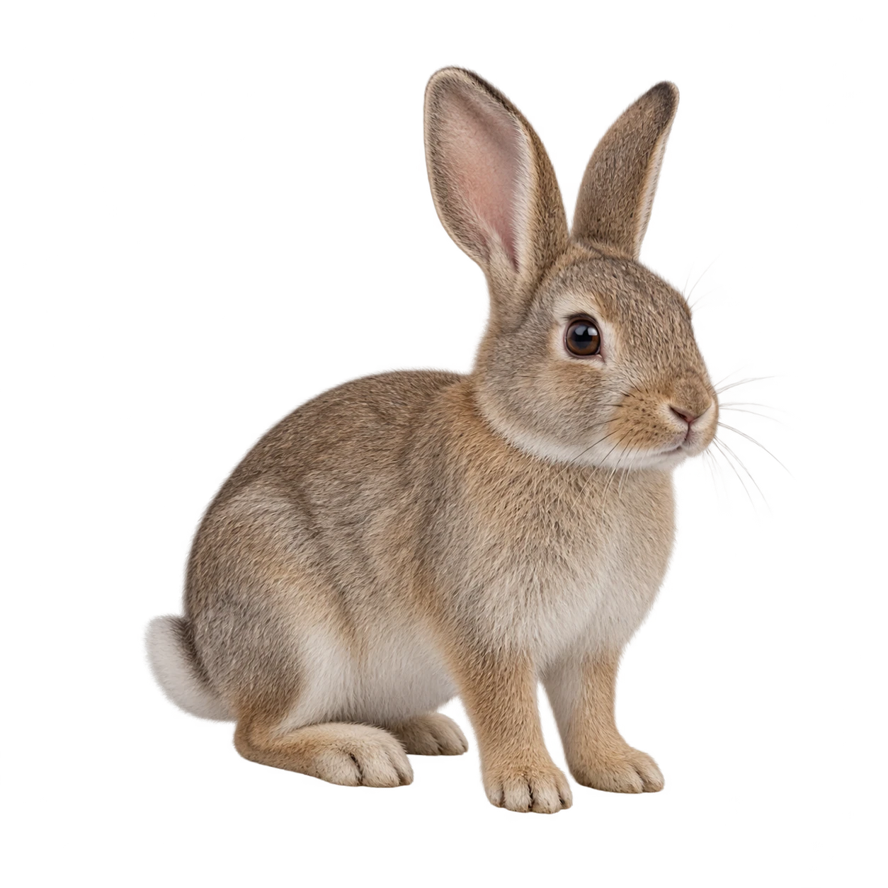
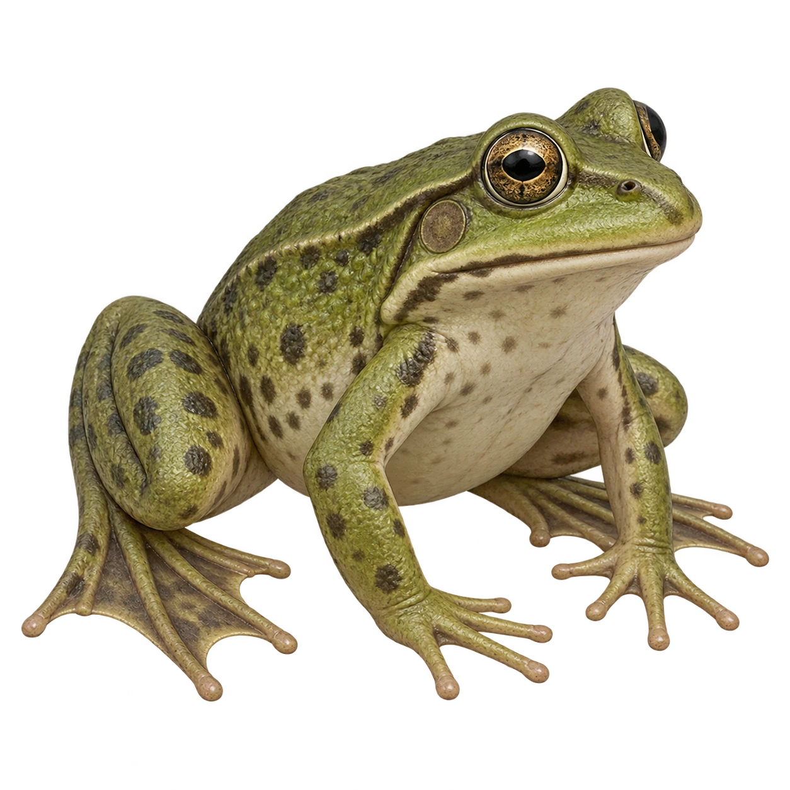
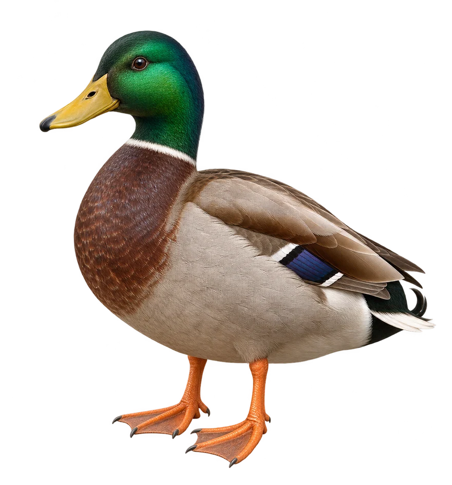
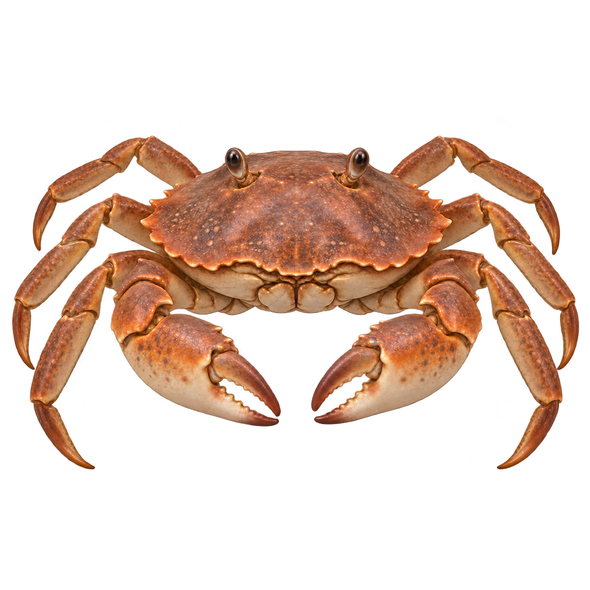
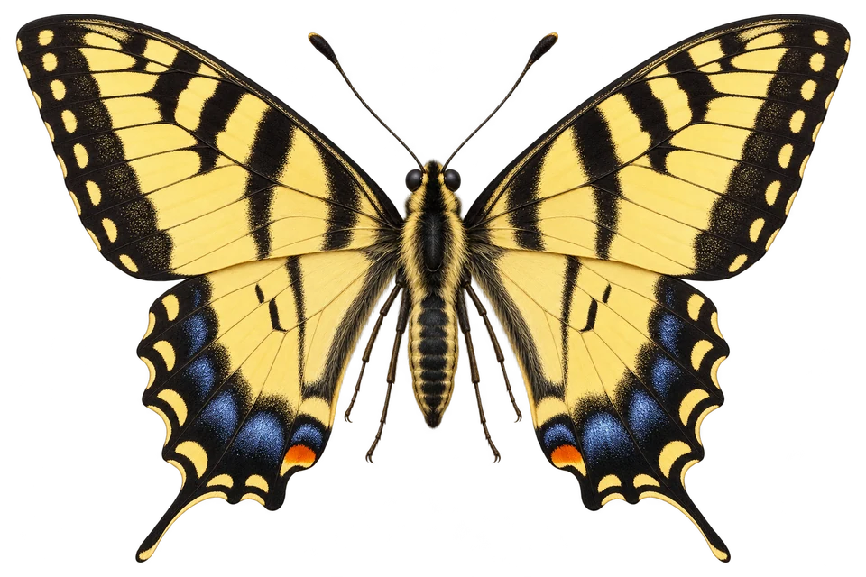
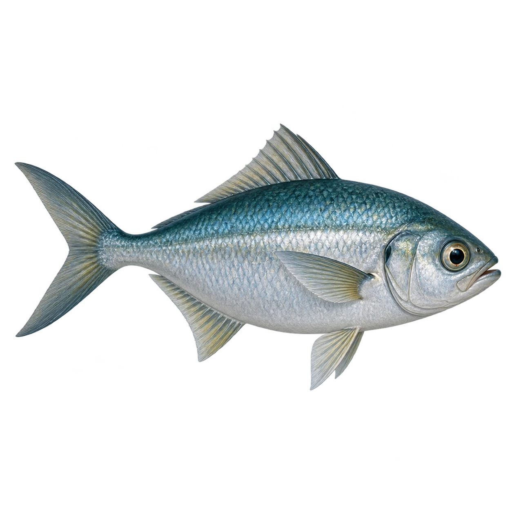

# 움직임 기록 — 동물별 초기 이미지·영상 프롬프트

기존 동물 이미지를 외형 참고로 첨부하고 **초기 이미지 프롬프트**로 첫 프레임을 만든 다음, 그 결과를 영상의 시작 이미지로 넣어 줘. 아래 영어 블록은 각각 그대로 복사해서 사용할 수 있어. 현재 앱의 학습 목표에 맞춰 개구리는 **헤엄치기**, 게는 **옆으로 걷기**로 구성했어.

공통 설정: 가로 16:9, 5초, 1080p, 무음, 한 컷. 카메라 고정. 동물은 화면 가로의 약 40~50%를 차지하고 이동 여백을 확보. 서식지는 뒤쪽과 가장자리에 은은하게 보이되 장소를 알아볼 수 있을 만큼 형태를 유지. 동물과 핵심 신체 부위는 선명하게, 배경은 약하게만 흐리게 처리. 약 2초 지점에 관찰할 핵심 동작이 오도록 구성. 자막·화살표는 영상에 넣지 않고 앱에서 표시. 생성 툴이 5초를 지원하지 않으면 가장 가까운 길이를 선택하고 같은 동작 비율을 유지해 줘. 모델·가격은 실행 시점에 확인해야 해.

| 컷 | 동물 | 사이즈 | 앵글 | 무브먼트 | 길이 | 관찰할 장면 |
|---|---|---|---|---|---|---|
| 1 | 토끼 | 서식지를 포함한 전신 | 지면 높이 측면 | 고정 | 5초 | 뒷다리로 땅을 미는 순간 |
| 2 | 개구리 | 서식지를 포함한 전신 | 물속 위쪽 사선 | 고정 | 5초 | 뒷다리·물갈퀴로 물을 미는 순간 |
| 3 | 오리 | 서식지를 포함한 전신 | 수면 단면 측면 | 고정 | 5초 | 물갈퀴로 물을 뒤로 미는 순간 |
| 4 | 게 | 서식지를 포함한 전신 | 지면보다 약간 높은 정면 | 고정 | 5초 | 걷는 다리가 땅을 미는 순간 |
| 5 | 나비 | 서식지를 포함한 전신 | 약간 높은 사선 | 고정 | 5초 | 날개를 아래로 내리는 순간 |
| 6 | 바다 물고기 | 서식지를 포함한 전신 | 위쪽 사선 | 고정 | 5초 | 몸·꼬리를 좌우로 움직이는 순간 |

## 1. 토끼

외형 참고 / 업로드 파일: `assets/generated/rabbit.webp`



초기 이미지 프롬프트:

```text
Use the reference only for this rabbit's appearance: preserve its fur color, ear shape, proportions and natural anatomy. Exactly one rabbit. Do not copy the reference background.
[CAMERA] Static camera, ground-level side view, full-body shot, facing right. Keep the entire animal, ears and feet visible, occupying about 45% of the frame. Leave open ground ahead on the right. 16:9. The animal spans about 40–50% of the frame width; preserve room for the full movement and readable habitat around it. Use moderate depth of field, with the animal sharp and the habitat only gently softened. No blank studio background or extreme bokeh.
[SCENE] A realistic storybook rabbit on a mossy path at the edge of a forest in soft daylight. The hind legs are visibly bent beneath the body, preparing to push off. Four anatomically correct legs; near hind foot and ground contact unobstructed. Recognizable but subdued tree trunks, low ferns and leaf litter behind the path; gently softened background, tactile natural fur, no clothing, no people, no text, no arrows, no watermarks.
```

영상 프롬프트:

```text
Preserve the reference rabbit's brown-gray fur, upright ears, proportions and identity. Exactly one rabbit with natural rabbit anatomy throughout. Preserve the starting image's lighting and environment.

[CAMERA]
One continuous 5-second shot, 16:9. Locked camera, no movement.
Strict 90-degree side view, camera at the rabbit's hind-knee height.
Full body including ear tips, hind feet and ground contact must remain in frame.
The rabbit occupies about half the image width, starting left of center, facing right.
Keep the near hind leg clearly visible against the background.
End with the entire rabbit slightly right of center, resting after landing.

[SCENE]
A realistic rabbit on a flat, unobstructed mossy forest path.
Soft daylight; the brown rabbit separates clearly from the softly blurred green background.
No plants or stones in front of its legs.
Show ONE short forward hop in clear educational slow motion.
The main subject is the long hind leg folding, extending and pushing against the ground.

0.0–1.5 seconds: The rabbit lowers its rump and deeply folds its long hind legs beneath its body. The near hind foot rests firmly on the ground. Make the folded thigh, lower leg and long hind foot readable in silhouette. At 1.2 seconds, clearly show the crouched preparation pose.

1.5–3.15 seconds: Show the complete push-off slowly and continuously. The hind feet press against the ground while the hips, knees and ankles extend in sequence. The rump rises and moves forward as the hind legs straighten backward. At 2.8 seconds, show the near hind leg almost fully extended, with the hind toes still visibly pushing against the ground. The forefeet have lifted; propulsion visibly comes from the hind legs.

3.15–3.9 seconds: The hind toes leave the ground and the body travels forward in a low natural arc. At 3.5 seconds, clearly show forward flight with the extended hind legs trailing behind.

3.9–4.6 seconds: The forefeet touch down first, then the hind legs swing forward beneath the body and land naturally.

4.6–5.0 seconds: Hold a calm resting pose. Keep the full rabbit and its feet visible.

Avoid: walking or running cycles, tiny shuffling steps, jumping in place, feet sliding on the ground, floating without a push-off, legs hidden by the body or vegetation, extra or fused limbs, camera rotation, zoom, cuts, heavy motion blur, text, arrows, watermarks or audio.
```

2026-10-21 수정: 뒷다리 접기 → 펴며 지면 밀기 → 도약을 분리했다. 앱의 기존 장면 선택 시점(1.2 / 2.8 / 3.5초)과 땅 밀기 구간(2.45–3.1초)에 맞춘 5초 영상이다. 생성 후 실제 프레임이 지시한 동작과 일치하는지 확인한다.

## 2. 개구리

외형 참고 / 업로드 파일: `assets/generated/frog.webp`



초기 이미지 프롬프트:

```text
Use the reference only for the frog's appearance: preserve its green skin, markings, head and body proportions. Exactly one frog. Do not copy the background.
[CAMERA] Static underwater camera looking slightly down at a three-quarter view from behind and to the side. Full-body shot with both hind legs and webbed hind feet visible. Head points toward the upper-right, body occupies 45% of frame. 16:9. The animal spans about 40–50% of the frame width; preserve room for the full movement and readable habitat around it. Use moderate depth of field, with the animal sharp and the habitat only gently softened. No blank studio background or extreme bokeh.
[SCENE] A frog suspended in clear shallow pond water, hind legs folded outward and forward in preparation for a swimming kick. Forelegs held near the body. A visible shallow pond habitat: sandy and silty bottom, a few small pebbles, sparse submerged plant stems at the rear edges, and soft daylight filtering through the surface above. Keep an open clear-water corridor around both hind feet. Anatomically correct four limbs and delicate webbing between hind toes. No air jump, no floating above the surface, no text, arrows or people.
```

영상 프롬프트:

```text
Preserve the exact single frog's anatomy, skin and underwater setting from the starting image. Keep both hind legs and webbed feet visible throughout.
[CAMERA] Locked-off underwater camera, zero movement, slightly elevated rear three-quarter angle, full-body shot for 5 seconds. End with the frog fully visible slightly farther forward in the same frame. No cut or zoom.
[SCENE] The shallow pond bottom, scattered pebbles and distant submerged stems remain visible and spatially consistent. Faint sunlight ripples may move over the bottom, but no plants, silt clouds or reflections obscure the hind feet. 0–1 seconds: the frog gathers its bent hind legs close to the body. 1–2.5 seconds: both hind legs extend backward together, webbed feet spread and push water backward in one clear slow swimming kick. 2.5–4 seconds: the frog glides forward with hind legs extended and then gently folds them back. 4–5 seconds: a short quiet glide. Emphasize leg extension and spreading webbed feet around 2 seconds. The frog remains submerged at all times. No hopping, mammal paddling, extra limbs, fins, text, arrows or audio.
```

## 3. 오리

외형 참고 / 업로드 파일: `assets/adventure/duck.webp`



초기 이미지 프롬프트:

```text
Use the reference only for the duck's exact feather colors, bill, head and body proportions. Exactly one duck, two webbed feet, no added animals.
[CAMERA] Static side view, full-body shot facing right, split-level waterline composition like a clear pond observation window. Both the duck above water and its feet below water are visible. 16:9. The animal spans about 40–50% of the frame width; preserve room for the full movement and readable habitat around it. Use moderate depth of field, with the animal sharp and the habitat only gently softened. No blank studio background or extreme bokeh.
[SCENE] The duck floats naturally on a calm clear pond. Its near orange webbed foot is brought forward beneath the belly, preparing to paddle backward; the farther foot is anatomically separate. Waterline crosses the lower body, not the feet. Soft daylight, a low grassy pond bank and a small reed clump above the water in the rear background, with a pale muddy bottom and a few submerged stems visible well behind the feet below the waterline, realistic feather and webbing detail. No labels, text, arrows or decorative bubbles hiding the feet.
```

영상 프롬프트:

```text
Preserve the single reference duck, its two webbed feet, feather pattern and split-level pond setting. Keep the underwater feet visible without refraction distortion.
[CAMERA] Locked-off side camera, zero speed, full-body split-level framing for 5 seconds. Maintain the waterline and the visible feet. End with the entire duck a little farther right, still inside the same frame. No pan, zoom or cuts.
[SCENE] The grassy pond bank and rear reeds remain visible above the water; the pale bottom and sparse distant stems remain visible below it. Only small surface ripples and a gentle reed sway. Keep all ripples and reflections away from the view of the webbed feet. 0–1 seconds: the near foot moves forward with toes slightly gathered. 1–2.5 seconds: its toes spread to expose the webbing, and the foot sweeps backward through the water, pushing water backward as the duck moves forward. 2.5–4 seconds: the foot folds slightly and returns forward while the other foot paddles naturally. 4–5 seconds: gentle forward glide. Show the broad webbed surface clearly around 2 seconds. Wings remain folded. No running on water, backward travel, extra feet, text or audio.
```

## 4. 게

외형 참고 / 업로드 파일: `assets/generated/crab.webp`



초기 이미지 프롬프트:

```text
Use the reference only for the crab's shell color, body shape and anatomy. Exactly one crab, two front claws and eight walking legs. Do not copy the background.
[CAMERA] Fixed full-body front view from slightly above ground level so the entire walking-leg arrangement is visible. Crab faces the camera; leave space to the right for sideways travel. 16:9. The animal spans about 40–50% of the frame width; preserve room for the full movement and readable habitat around it. Use moderate depth of field, with the animal sharp and the habitat only gently softened. No blank studio background or extreme bokeh.
[SCENE] A crab on damp firm tidal sand, legs naturally spread and bent with the feet touching the ground. Claws lifted slightly clear of the walking surface. A recognizable tidal-flat background with shallow tide pools, subtle wet-sand ripples and low distant shoreline rocks, gently softened but not reduced to abstract blur, warm diffuse daylight, detailed shell texture. No other animals, footprints obscuring feet, text or arrows.
```

영상 프롬프트:

```text
Preserve the same single crab, shell, two claws and eight walking legs from the starting image. Keep its body facing the camera throughout.
[CAMERA] Locked-off camera, zero camera movement, slightly elevated frontal angle, full-body shot for 5 seconds. Maintain room on both sides. End with the crab fully visible slightly right of center, facing the original direction.
[SCENE] The tidal pools, wet-sand ripples and low distant shoreline rocks remain recognizable and gently softened. Water moves faintly only in the rear pools; no incoming wave covers the crab or its contact with the sand. 0–1 seconds: the crab shifts its weight and lifts a few walking feet. 1–3 seconds: two slow natural sideways steps to the right; walking legs alternate between planting, pushing against the sand and lifting. The shell translates sideways without rotating. Make the planted legs pushing the ground especially clear around 2 seconds. 3–4 seconds: finish the second step. 4–5 seconds: settle on the sand. Claws do not act as walking feet. No forward-facing human walk, leg multiplication, sliding, teleporting, text or audio.
```

## 5. 나비

외형 참고 / 업로드 파일: `assets/adventure/butterfly.webp`



초기 이미지 프롬프트:

```text
Use the reference only for the butterfly's exact wing pattern, colors and body. Exactly one butterfly with two pairs of wings, two antennae and six small legs. Do not copy the background.
[CAMERA] Fixed full-body three-quarter side view from slightly above the butterfly. Show both sides of the wing motion clearly with generous space above and below. 16:9. The animal spans about 40–50% of the frame width; preserve room for the full movement and readable habitat around it. Use moderate depth of field, with the animal sharp and the habitat only gently softened. No blank studio background or extreme bokeh.
[SCENE] A butterfly just above meadow flowers in soft natural daylight. Wings raised in preparation for a downward stroke, narrow body horizontal, a recognizable meadow of small wildflowers and grasses in the lower and rear background, softly detailed and unobtrusive. Leave open air around the wings; no stems cross the butterfly. Accurate delicate wing veins and antennae, realistic storybook texture. No duplicate butterfly, exaggerated face, text, arrows or motion blur.
```

영상 프롬프트:

```text
Preserve the exact single butterfly and all wing patterns from the starting image. The forewings and hindwings remain anatomically attached and consistent throughout.
[CAMERA] Locked-off camera, zero movement, slightly elevated three-quarter angle, full-body shot for 5 seconds. Keep every wing tip inside the frame. End with the butterfly fully visible near the center in a balanced flight pose. No tracking, zoom or cuts.
[SCENE] The small meadow flowers and grasses remain visible in the rear and lower frame with a very slight breeze. Keep the butterfly sharp and the habitat gently softened; no flower or stem crosses the wing silhouette. Show two gentle wingbeat cycles in educational slow motion. 0–1 seconds: wings reach the raised position. 1–2.5 seconds: the wings sweep downward clearly as the butterfly maintains flight and drifts slightly forward. 2.5–4 seconds: wings rise and perform a second natural stroke. 4–5 seconds: return to a raised-wing pose without freezing unnaturally. The downward stroke is clearest around 2 seconds. No rigid paper-wing rotation, changing patterns, extra wings, fast blur, text or audio.
```

## 6. 바다 물고기

외형 참고 / 업로드 파일: `assets/generated/marine_fish.webp`



초기 이미지 프롬프트:

```text
Use the reference only for this fish's exact body shape, colors, scales and fins. Exactly one fish. Do not copy the background.
[CAMERA] Fixed elevated three-quarter view, full-body shot looking diagonally down so left-right body and tail bending is visible. Fish faces right. 16:9 with clear forward space.
[SCENE] A fish swimming in clear shallow seawater above a visible sandy seabed with a few low rocks and sparse seagrass at the distant edges. The clear blue-green water and gently softened seabed establish a coastal marine habitat; keep open water around the entire body and tail. Body nearly straight with the tail gently bent to one side, fins naturally spread. Soft underwater sunlight, clear silhouette and entire tail visible. No other animals, text, arrows, decorative bubbles or aquarium objects.
```

영상 프롬프트:

```text
Preserve the exact single fish, scale pattern, fin count and underwater environment from the starting image. Keep the body and tail anatomically continuous.
[CAMERA] Locked-off camera, zero movement, elevated three-quarter full-body view for 5 seconds. Keep the entire tail visible at all times. End with the fish a little farther right, fully within the original composition. No zoom, pan or cuts.
[SCENE] The coastal sandy seabed, low rocks and sparse distant seagrass remain recognizable and spatially consistent. Allow subtle underwater light and a slight distant seagrass sway; keep clear open water around the tail. 0–1 seconds: the rear body and tail bend gently to one side. 1–2.5 seconds: the bend travels backward and the tail sweeps to the opposite side, pushing water sideways as the fish advances forward. 2.5–4 seconds: one more smooth lateral tail cycle, with the smaller fins stabilizing the body. 4–5 seconds: settle into a short forward glide. Emphasize side-to-side bending around 2 seconds. The tail never flaps vertically like a dolphin. No body morphing, extra fins, backward swimming, text or audio.
```

총 러닝타임: **6편 × 5초 = 30초**. 파일명 권장: `rabbit.mp4`, `frog.mp4`, `duck.mp4`, `crab.mp4`, `butterfly.mp4`, `marine.mp4`.

생성 후 확인: 배경만 보고도 서식지를 알아볼 수 있는지, 배경이 핵심 동작을 가리지 않는지, 발·날개·지느러미 개수가 유지되는지, 핵심 동작이 2초 근처에 선명한지, 몸 전체가 화면 안에 남는지 확인해 줘. 2026-10-18 사용자가 제공한 6편을 실제 앱에 연결했어. 배포본은 `assets/videos/motion/`, 원본은 `files/videos/source-20261018/`에 있어. 실제 영상에서 확인한 시점에 맞춰 재생·느리게 보기·장면 선택·기록 판정을 연결했고, 불러오기 실패 시 설명 모형으로 전환해. 생성 원본과 변환 정보는 `MOTION-VIDEOS-20261018.json`을 참고해.

## 7–8. 낙타·펭귄 추가 영상 (2026-10-18 완료)

| 동물 | 사이즈 | 앵글 | 무브먼트 | 길이 | 관찰 목적 |
|---|---|---|---|---|---|
| 낙타 | 서식지를 포함한 전신 | 발을 볼 수 있는 낮은 측면 | 고정 | 5초 | 넓적한 발바닥으로 모래 딛기 |
| 펭귄 | 서식지를 포함한 전신 | 수중 위쪽 사선 | 고정 | 5초 | 짧은 날개로 물을 밀며 헤엄치기 |

Kling v3.0 Pro · 16:9 · 무음, 2편 합계 견적 15크레딧. 전체 LOCK·CAMERA·SCENE 프롬프트와 완료 작업 ID는 [생성 기록](EXTRA-MOTION-VIDEO-JOBS-20261018.json)에 보관했어. 기존 3D 모형 입력 이미지를 보고 외형을 기술한 텍스트 기반 생성이야. 마지막에는 동물 전신이 프레임 안에 남도록 구성했어. 두 영상 총 10초.

앱에서는 건조한 곳·추운 곳의 동물을 발견하면 선택 관찰로 열려. 필수 세 마리 기록 및 탐험 별 18개 조건은 유지해. 실제 영상을 검수해 낙타 1.2/2.0/4.6초, 펭귄 0.8/2.4/4.6초를 장면 버튼에 연결했어.
