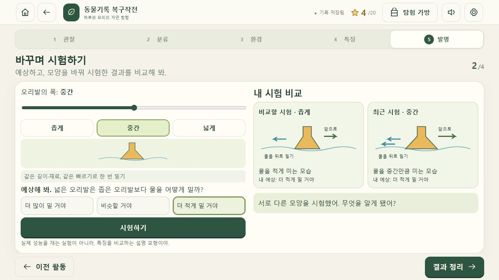
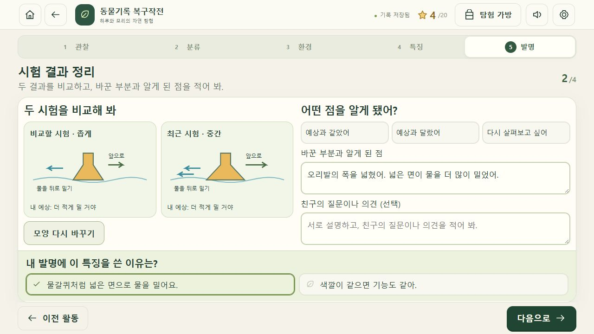

# 태블릿 탐구 경험 구현·검토 — 2026-10-16

대상: 동물기록 복구작전 0.4.0. 기존 5장·20활동, 이미지 자산과 저장 기록을 유지하면서 직접 관찰·예상·비교가 필요한 활동을 추가했다. 외부 배포는 하지 않았다.

## 핵심 구현

| 장 | 직접 해 보는 일 | 종이 학습지보다 프로그램이 필요한 이유 |
|---|---|---|
| 관찰의 숲 | 그림 위 렌즈 이동, 몸 부분 선택, 확대 내용과 특징 기록 | 조작하는 부분과 확대 화면이 연결되고 탐구 기록으로 남는다. 드래그 대신 부분 버튼으로도 사용할 수 있다. |
| 분류의 정원 | 먼저 분류한 뒤 이동을 예상하고 기준을 바꾸어 전후 비교 | 같은 동물도 기준에 따라 다른 집단으로 옮겨지는 것을 바로 확인한다. 바뀐 동물은 표시된다. |
| 생태의 물가 | 동물 발견, 종별 움직임 재생·느리게·정지·장면 선택·기록 | 몸의 어느 부분이 움직임과 연결되는지 시간을 멈춰 확인한다. 실제 동영상이 아닌 단순한 설명 그림이다. |
| 동물 찾기 안내소 | 몸 일부의 단서를 모아 후보를 좁히고 환경·생활 연결 | 새 증거에 따라 후보가 줄어들며 두 단서가 모두 있어야 선택할 수 있다. |
| 발명의 공방 | 관찰→설계→모양 변경→예상→두 설정 시험→비교→설명 | 바꾼 부분과 결과가 연결되고, 이전 시험과 현재 시험을 한 화면에서 비교한다. 예상이 틀려도 탐구를 이어갈 수 있다. |

첫 발명은 물갈퀴를 이용한 오리발로 안내하고, 두 번째는 등딱지를 이용한 덮개 또는 털의 특징을 이용한 방한 외투를 선택한다. 폭·감싸는 범위·공기를 머금는 겹을 각각 조절한다. 시험 전 미리보기에는 결과 화살표를 표시하지 않는다. 같은 재료·길이·움직임 등 비교 조건을 짧게 제시한다.

시험은 정성적인 설명 모형이다. 실제 추진력·속도·충격 보호 성능·보온 성능을 계산하거나 인증하지 않는다. 스케치는 아이디어 기록이며 선의 모양으로 성능을 자동 판정하지 않는다. 글은 작성 여부만 확인하고 내용의 과학적 타당성은 교사 피드백으로 확인한다.

## 초등학생용 화면·문구 수정

- 활동 제목, 짧은 행동 안내, 조작 영역, 다음 행동 순서로 정리했다. 반복되는 장 이름·진행 설명·일반 격려 문장은 줄였다.
- 시험 조작과 결과 정리를 화면으로 나눴다. 1280×720에서 기본 설계·비교 시험·결과 정리 각각의 핵심 입력과 다음 버튼이 스크롤 없이 들어오는 것을 확인했다.
- 확대·기록·시험·결과 정리 등 버튼의 결과를 예측할 수 있는 말로 정리했다. 결과 정리 화면은 제목도 ‘시험 결과 정리’로 바뀐다.
- 드래그·조절 막대에 버튼 대안을 두고, 검토한 화면의 버튼·입력은 최소 44px 이상의 조작 영역을 확보했다.
- 태블릿 세로·좁은 화면은 내용을 위아래로 쌓고 스크롤을 허용한다. 환경 그림의 크기를 줄여 조작부가 지나치게 아래로 밀리지 않게 했다. 방향에 따라 틀리는 ‘왼쪽에서’ 안내를 ‘그림에서’로 바꿨다.
- 토끼 귀가 마지막 움직임 장면에서 잘리던 부분, 가로 화면에서 이름 입력과 설명 선택이 아래로 잘리던 부분을 수정했다.
- 그림 자료를 실제 사진으로 부르지 않도록 현재 화면의 문구를 정리했다. 생성형 그림과 설명 모형임을 제작 안내에 표시했다.
- 예상이 맞았는지로 별을 주지 않는다. 서로 다른 설정을 시험하고 비교·기록하는 과정을 확인한다.
- 현재 모양을 아직 시험하지 않았다면 결과 정리가 비활성화되고 ‘지금 고른 모양도 시험해 줘’가 표시된다.
- 수집한 관찰·환경·발명 기록이 지도와 최종 기록에 나타난다. 선택적인 친구 의견도 저장·내보내기에 포함된다.

## 교육과정 검토

공식 확인 자료: [경기도교육청 게시 초등학교 교육과정 PDF](https://www.goe.go.kr/resource/old/BBSMSTR_000000030136/BBS_202409110159438010.pdf), PDF 44쪽의 동물의 생활 성취기준. [국가교육과정정보센터 2022 개정 교육과정 고시 안내](https://ncic.go.kr/board/B0033.cs?act=read&bwrId=2105&pageIndex=1&pageUnit=10)도 확인했다.

아래는 원문 전체 인용이 아닌 활동 연결 요약이다.

| 성취기준 | 앱에서 확인할 활동 | 교실에서 함께 확인할 점 |
|---|---|---|
| [4과02-01] 동물 관찰·특징에 따른 분류 | 몸 부분 확대·기록, 공통점·차이 비교, 관찰 가능한 기준으로 분류, 기준 변경 비교 | 실제 사진·표본도 함께 보고 학습자가 기준을 말로 설명하는지 확인 |
| [4과02-02] 환경과 생김새·생활 방식의 관련성 | 여러 환경의 동물 발견, 몸의 움직임 장면 기록, 환경·몸·움직임 연결, 단서로 이유 설명 | 특정 동물이 한 환경에만 산다고 일반화하지 않도록 안내. 실제 생태 자료와 비교 |
| [4과02-03] 동물 특징을 활용한 생활용품 설계와 협력적 소통 | 특징에서 구조로 연결, 두 설정 비교, 설계 의도 기록, 친구의 질문·의견 기록 | 친구에게 설명→질문→의견 교환을 실제 수업에서 운영. 혼자 완료한 앱 기록만으로 협력적 소통 달성을 판정하지 않음 |

단순한 정답 선택만으로 세 성취기준을 모두 달성했다고 표시하지 않는다. 특히 글의 설명 수준과 협력적 소통은 학생의 실제 수행과 교사 관찰이 필요하다. 이 내용은 앱의 선생님 안내에도 반영했다.

## 자동 검증

- `npm run check`: JavaScript 구문 검사 통과.
- `npm test`: 58개 테스트 통과. 기존 판정·보상·저장 이관과 신규 탐구 모델·컨트롤러 회귀 포함.
- `npm run build`: 실행 파일 35개, 약 5.11 MiB. 신규 모듈·CSS 포함, 이미지 경로 검증.
- 같은 설정 반복으로 비교 완료 불가, 잘못된 예상 허용, 미시험 현재 설정으로 완료 불가, 추가 시험 후 회고 재확인, 다른 문제의 시험 기록 차용 방지 확인.
- 예전 0.3 저장에서 기존 별·완료 기록을 유지하고 새 필드를 안전한 초기값으로 추가하는 회귀 확인.
- 저장 실패 안내·복구, 사용자 글 이스케이프, 초안이 제출 결과를 덮어쓰지 않는 동작, 두 발명 독립 기록, 잘못 섞인 단서 복원 확인.

## 실제 브라우저 조작으로 확인한 범위

로컬 별도 포트 4175에서 검증용 기록을 사용했다. 기존 기본 포트의 사용자 기록을 초기화하지 않았다. 실제 태블릿이 아닌 데스크톱 브라우저의 화면 크기 변경 검증이다.

- 시작·안내·지도 이동·관리자 입장 해금 확인. 관리자 해금은 보상과 완료를 주지 않는다.
- 몸 부분 선택·확대·기록, 기준 변경 전 예상과 재분류, 두 단서 수집·후보 제한, 환경과 생활 연결 화면 확인.
- 토끼 움직임 재생·정지·느리게·장면 버튼·조절 막대·기록 확인. 조절 막대에서 끝 장면을 선택하면 값 100과 마지막 설명이 유지된다. 모달을 열면 재생이 중지되고 버튼 표시도 일치한다.
- 물갈퀴 관찰·오리발 설계·잘못된 예상·서로 다른 두 폭 시험·결과 정리·설명 작성·다음 발명 진입 확인.
- 두 설정 시험 후 미시험 설정으로 바꾸면 결과 정리가 잠기고, 해당 설정을 시험하면 다시 활성화되는 것을 확인했다.
- 새로고침 후 관찰·발명·글 기록 유지 확인. 브라우저 콘솔의 오류·경고 없음.

| 화면 크기 | 확인 내용 |
|---|---|
| 1280×800 | 확대 관찰과 주요 탐구 흐름 확인 |
| 1280×720 | 기본 설계·비교 시험·결과 정리의 작업 영역 높이와 내용 높이 441px로 일치, 가로 넘침 없음 |
| 1024×768 | 환경·움직임 화면과 주요 조작부가 화면 안에 표시, 44px 미만 버튼 없음 |
| 768×1024 | 환경 그림과 움직임을 세로 배치, 스크롤로 모든 조작 접근 가능, 가로 넘침 없음 |
| 375×812 | 환경·움직임의 세로 스크롤·글 줄바꿈·버튼 크기 확인, 가로 넘침 없음 |
| 1920×1080 | 결과 정리 화면의 전자칠판 크기 배치와 잘림 없음 확인 |

모든 활동을 모든 화면 크기에서 수동 완주한 것은 아니다. 20활동의 완료·보상 흐름은 자동 테스트로 검증했고, 브라우저에서는 신규 핵심 상호작용을 중심으로 점검했다.

## 독립 검토와 수정

별도 검토자가 학습 모델·사용 흐름·저장 복원을 검토했다. 종별 움직임 구분, 시험 전 결과 노출, 실시간 조절 반영, 모달 중 재생 표시, 관찰 기록 안내를 수정했다. 재검토에서 나온 조절 막대 값 덮어쓰기, 결과 정리 조건 불일치, 없는 버튼을 가리키던 오류 안내, 라운드가 섞인 단서 복원 오류도 수정하고 회귀 테스트를 추가했다. 최종 읽기 검토에서 이 네 문제가 남지 않았음을 확인했다.

## 남은 현장 확인

iPad Safari·Android Chrome의 실제 손가락 드래그, 가상 키보드·주소창 변화, 저사양 기기와 교실 동시 접속, 학생이 도움 없이 조작을 이해하는지는 현장에서 확인해야 한다. 학생 대상 관찰이나 학습 효과 검증을 완료했다고 주장하지 않는다.

초기 수업에서는 ‘무엇을 만져야 하는지 찾는가’, ‘왜 결과가 달라졌는지 설명하는가’, ‘친구의 질문을 듣고 설계를 설명하는가’를 관찰하면 된다.

